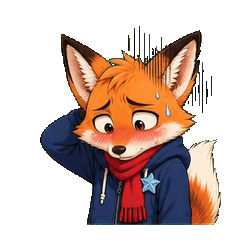
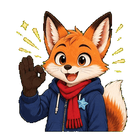
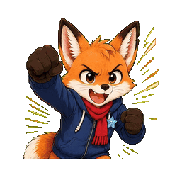

# weixin-sticker-gif

[中文说明](README.md) · [License](LICENSE)

An agent skill for making a complete animated WeChat sticker album from a subject description or reference image. It first generates **one subject image for approval**. After approval, it prefers GPT Image 2.6 to generate each looping GIF directly. Only items that cannot use or fail that route fall back to separate image-to-video jobs. It checks the final GIFs and packages the supporting submission artwork.

The skill can work with people, animals, plants, and objects. For scene GIFs, it keeps the background simple and fixed, without inventing moving vehicles or other objects that break the loop. Transparent direct GIFs are accepted only when actual frame alpha passes inspection. It checks the active agent's explicit GIF capability and account access before using an API or video fallback. Other provider routes require a check of permissions and charges.

## Preview

These existing public GIFs are 240×240, looping, and each under 500,000 bytes. They come from an earlier nine-cell experiment and illustrate output appearance, **not a verified run of the new GPT Image 2.6 album route**. [Source manifest](docs/assets/recent-sticker-pack/manifest.json).

| Embarrassed | Got it | Let's go |
| :---: | :---: | :---: |
|  |  |  |

Private reference-based tests also produced two football samples and a locally validated eight-sticker daily-life album with supporting assets. Their media is not included in this public repository. Local validation does not imply WeChat platform approval.

## Workflow

1. Provide a subject or reference image, theme, and 8–24 expressions or actions. Smaller sample requests are also supported.
2. Check image generation availability and cost; generate **one** subject anchor and wait for approval.
3. Decide whether the final GIFs should be transparent or keep a scene. Check explicit GPT Image 2.6 GIF output, account permission, and cost.
4. Generate one direct GIF per sticker where supported. Keep the scene sparse and stationary, and make the end pose return to the start. Save the original GIF and normalize it locally to 240×240 and at most 500,000 bytes.
5. Inspect identity, motion, background, and the visual loop seam. For unsuitable or failed items only, make action stills and use the existing independent-video route after rechecking cost.
6. After all GIFs pass, create a 750×400 banner, 240×240 cover, 50×50 icon, and by default a 750×560 / 750×750 reward-art pair. Validate and package a Chinese-named ZIP.

The [Chinese README](README.md#制作流程) contains the Mermaid diagram, a sample request, output tree, and current validation boundaries. The skill entry point is [SKILL.md](SKILL.md), with the [direct GIF workflow](references/direct-gif-workflow.md), [full workflow](references/full-album-workflow.md), and [submission asset specifications](references/album-submission-assets.md). The API route has not yet been exercised with a live account; a ChatGPT GIF sample passed file-size normalization but showed a visible loop seam.

## License

Source-available for noncommercial use. Original contributions and modifications are offered under [PolyForm Noncommercial 1.0.0](LICENSE); commercial use requires separate permission. Previously MIT-licensed portions retain their original rights and copyright notice in [LICENSE.upstream](LICENSE.upstream). This noncommercial restriction does not revoke those existing MIT rights. Rights in likenesses, trademarks, third-party models, and generated media may require separate permission. This project is not OSI open source because OSI open source permits commercial use.
