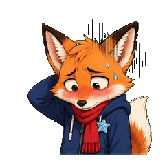
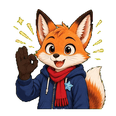
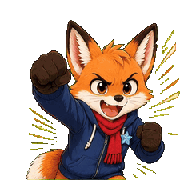
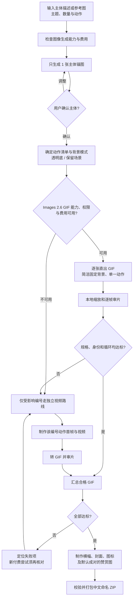

# weixin-sticker-gif

**从一个主体或一张参考图，制作一套可交付的微信动态表情包。** 这个独立 Agent Skill 先生成 **一张主体图**供你确认，再优先用 Images 2.6 逐张直出循环 GIF；直出不适用或未过关的编号才走独立视频路线。最后补齐横幅、封面、图标和赞赏素材，打包成中文命名的 ZIP。

[制作流程](#制作流程) · [效果示例](#效果示例) · [如何使用](#如何使用) · [许可与来源](#许可与来源) · [English](README.en.md)

## 它能做什么

- **主体一致：**输入人物、动物、植物、物体的描述或参考图；先只做一张主体锚图，确认身份和画风后才批量制作。锚图只确认角色，场景在动作 GIF 提示词或视频回退阶段生成。
- **真正的动作：**优先让 Images 2.6 为每个动作直接生成多帧 GIF，省去视频转码；只有未过关的编号才制作动作首帧和独立视频。不依赖一段九宫格视频切出整套。
- **按需求处理背景：**明确要场景或底色就保留画面，背景保持简洁、固定，不自行增加车辆等持续移动杂物；想要透明底时，仅在直出 GIF 逐帧确有真透明像素时使用，否则走透明底视频路线。
- **适配当前 Agent：**核实正在运行的 Agent 是否能显式指定 Images 2.6 和 GIF 输出；普通生图返回 PNG 不算成功。其次检查已配置的 Image API 或可下载原始 GIF 的 ChatGPT 界面；直出均不可用时再核验视频模型账号、权限和费用。已集成 Grok、MiniMax H3、Wan 3.0 等视频回退路线；Seedance 对真人素材另做资格检查。
- **一套交付：**8–24 张统一画风、动作有差异的 240×240 循环 GIF；通过大小和画面检查后，再制作微信投稿所需的附加素材与 ZIP。也可以先试做 1–7 张样片。

“一键”指**主体图获确认、费用与模型已确定后**，由 Agent 连续编排制作和本地打包；它不会跳过主体确认、可能的额外付费告知或成品审片。

## 效果示例

下面的“暖尾狐狸”GIF 是仓库已收录的动态案例，可直接预览循环效果。这三张均为 240×240、24 帧、无限循环，单张小于 500KB。它们来自早期九宫格试验，**展示最终 GIF 的效果，不代表 Images 2.6 直出整套流程已跑通**。来源和校验信息见 [案例清单](docs/assets/recent-sticker-pack/manifest.json)。

| 社死 | 收到 | 冲鸭 |
| :---: | :---: | :---: |
|  |  |  |

我们还用真人参考图做过 **2 张足球动态样片**，并用卡通人物完成过 **8 张日常主题 GIF、五类附加素材和本地 ZIP 校验**。这批素材来自私人参考图，当前未放进公开仓库；上述狐狸案例是公开可看的效果样例。8 张专辑的本地文件校验不等于微信平台审核通过，也不等于所有视频模型都已完成真实端到端验证。

更多静态风格探索与处理证据见 [风格画廊](gallery/README.md)。

## 制作流程



主体图不要求预先画出足球场、房间等最终场景。直出 GIF 的背景尽量简单、固定；透明底不能只凭提示词宣称成功。详细执行规则见 [完整成套流程](references/full-album-workflow.md)、[直出 GIF](references/direct-gif-workflow.md)、[背景与质量规则](references/output-contract.md)和 [模型连接与费用](references/video-connections.md)。

## 交付内容

默认完整专辑的 ZIP 只放投稿图片，技术报告保存在 ZIP 旁边：

```text
<中文专辑名>表情包.zip
├── 表情/
│   ├── 收到.gif
│   ├── 大笑.gif
│   └── …（共 8–24 张，文件名各不相同）
├── 详情页横幅.png      750×400
├── 表情封面.png        240×240，透明
├── 聊天页图标.png      50×50，透明
├── 赞赏引导图.png      750×560
└── 赞赏致谢图.png      750×750
```

主表情必须同为动态 GIF、240×240、每张不超过 500,000 字节，并设置循环；主题文件名为互不重复的 1–4 字中文。赞赏图默认成对制作，用户明确不要时两张均省略。附加素材的规格、命名和校验边界见 [投稿素材与打包](references/album-submission-assets.md)。最终仍需人工查看角色一致性、动作差异、留白、文字和边缘；微信投稿以当时平台页面要求与审核结果为准。

## 如何使用

将本仓库作为 `weixin-sticker-gif` Skill 提供给支持本地 Skill 的 Agent，在对话中给出需求即可；具体安装方式取决于所用 Agent。示例：

```text
用 weixin-sticker-gif，以附件人物为主体，做 8 张日常主题微信动态表情：
收到、大笑、抱抱、谢谢、加油、惊讶、委屈、晚安。
先只生成一张主体图给我确认。最终保留房间场景，不要抠背景。
优先用 Images 2.6 直出 GIF；背景保持简洁，不自行增加持续移动的物体。如果需要额外付费，先告诉我费用。
```

也可指定“透明底”“先做两张样片”或某个视频模型。API Key 不写进 Skill、提示词或仓库；直出 GIF 的 API 调用要求当前进程已有 `OPENAI_API_KEY`，视频 API 仍按 [连接说明](references/video-connections.md) 配置。已登录不等于有生成权限，额外付费、重试和换模型都要先明确费用与授权。

开发或本地运行脚本时，可在仓库目录创建 Python 虚拟环境并安装依赖：

```bash
python3 -m venv .venv
.venv/bin/python -m pip install -r requirements.txt
npm ci --ignore-scripts
```

Agent 执行入口见 [SKILL.md](SKILL.md)；脚本与更多细节见 [流程总览](references/workflow-map.md)。

## 当前验证范围

- 公共 GIF 案例可预览；本 README 展示的三张满足 240×240、循环和 500KB 本地检查。早期九宫格案例中另有一张超过当前 500KB 门槛，因此不把九张整体宣称为投稿就绪。
- Grok 已用于本地足球双样片；日常主题八张与附加素材已完成本地 ZIP 文件校验。视觉质量和微信审核仍需逐项检查。
- ChatGPT GIF 界面曾生成一张有背景的 9 帧样片，缩至 240×240 后通过体积检查，但公交车持续靠近造成首尾跳变；它证明直出与本地压缩可行，不证明 Image API 已接通或整套质量达标。
- MiniMax H3、Wan 3.0、Seedance 的实际可用性取决于账号、模型权限和素材资格；本地适配或探测成功不代表真实生成已验证。外部调用可能产生费用。

## 许可与来源

本项目**源码公开，限非商业使用**。本项目新增与改造的代码和文档按 [PolyForm Noncommercial 1.0.0](LICENSE) 提供；商用须另行取得权利人许可。它不属于 OSI 定义的“开源软件”，因为该定义允许商业使用。项目沿用的原有 MIT 代码与文档仍按其原授权使用；本项目的非商业条款**不能撤销这部分已授予的 MIT 权利**。非商业条款见 [LICENSE](LICENSE)，原 MIT 文本及版权声明见 [LICENSE.upstream](LICENSE.upstream)。角色肖像、商标、第三方模型和生成媒体的使用权请分别确认。
